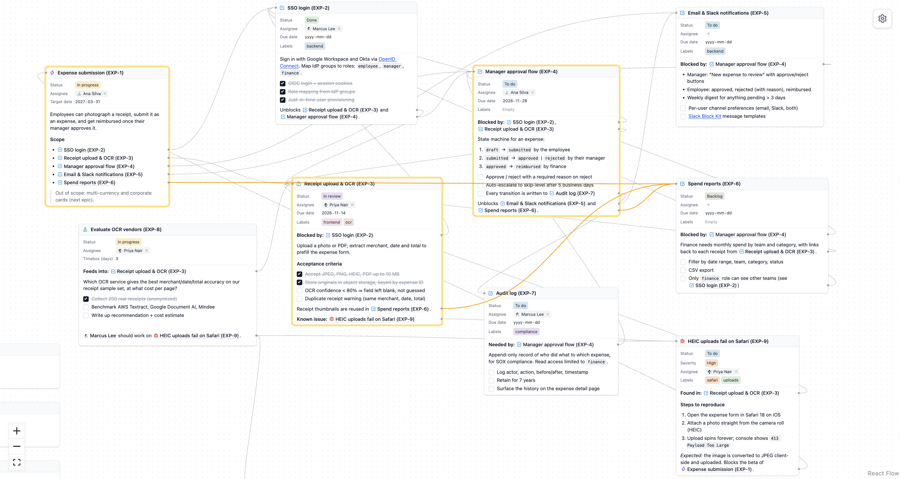

# Hyper

A canvas of connected notes. Write rich-text notes, link them by `@mentioning` each other, and
Hyper draws the links for you. Give notes a type (Task, Bug, Epic, User, or one you design) and
they get structured fields: status, assignee, dates, labels, and anything else you define.



## What you can do

### Write on an infinite canvas

- **Double-click anywhere empty** to create a note right there.
- Scroll with two fingers to pan; pinch (or `Ctrl/Cmd` + wheel) to zoom, anywhere, including over notes.
  Zoom far out to see a whole board.
- Drag notes by their title bar; drag the bottom-right corner to make a note wider or narrower.
  Notes always grow to fit their content, so nothing is ever hidden behind a scrollbar.
- **Double-click a title to rename** a note. Every mention of it updates instantly.

### Format with Markdown shortcuts

Notes are rich text, formatted as you type:

| Type                                 | Get                        |
| ------------------------------------ | -------------------------- |
| `# `, `## `, `### `                  | Headings                   |
| `- ` / `* `, `1. `                   | Bulleted / numbered lists  |
| `[] `, `[x] `                        | Checklists (click to tick) |
| `> `                                 | Quote                      |
| `**bold**`, `*italic*`, `~~strike~~` | Inline formatting          |
| `` `code` ``                         | Inline code                |
| `[text](url)`                        | Link                       |

`Cmd/Ctrl+B`, `I` and `U` work too, and `Tab` / `Shift+Tab` nest list items. URLs and email
addresses you type or paste become links automatically.

### Link notes with `@mentions`

- Type `@` and start typing: notes are **fuzzy-matched** (`mgr appr` finds "Manager approval
  flow"), and names can have spaces and dashes.
- **Mention a note that doesn't exist yet**: type its name and press `Enter`. Hyper creates it to
  the right of the current note, so you can sketch out several related notes without leaving the
  editor.
- A mention always points at the same note, even after it's renamed. If that note is deleted, the
  mention says so instead of pointing somewhere else.
- **Click a mention** to pan the canvas to that note.

### See how everything connects

Links are never drawn by hand. Each `@mention` _is_ a link, running from the exact line where the
mention sits to the title of the note it points to. Edit the text, resize the note, or rename
something, and the links follow.

- **Hover a mention** to highlight the note it points to and the link that leads there.
- **Click a link** to highlight it and the notes at both ends.
- **Click the dot next to a note's title** to highlight every note that links to it.

### Give notes a type and fields

Click the icon in a note's title bar to choose its type and, optionally, its own **icon** and a
**color**. A colored note gets a tinted title bar, and every mention of it is highlighted in the
same color, so an epic or a bug stands out wherever it's referenced. Types come with **fields**,
shown and edited right inside the note:

| Field type        | Holds                                                          |
| ----------------- | -------------------------------------------------------------- |
| Select            | One option from a list (e.g. Status: To do, In progress, Done) |
| Multi-select      | Several options (e.g. Labels)                                  |
| Text, Number      | Free values                                                    |
| Date, Date & time | A specific date                                                |
| Icon              | Any icon from a searchable picker, including custom icons      |
| Image             | An image URL                                                   |
| Reference         | Other notes, optionally of one type (e.g. Assignee → a User)   |

Select fields work like Notion: pick from colored options, type a new name to create one on the
spot, and rename, recolor or delete options from the same menu.

Any field can hold one value or several, and can be **mandatory** with a default that new notes
start with.

### Design your own workspace

Open **Workspace settings** (the gear, top right, or `Cmd+,` / `Ctrl+,`) to:

- **Create fields** once and reuse them across types. Rename a field and it changes everywhere.
- **Create types** (schemas) with a name, an icon, a color, and an ordered set of fields.
- **Add custom icons**: a name (slug) and an image URL. They show up in every icon picker, so
  you can use them for a note (like a person's avatar), a type, a field, or an Icon field.
- **Change things safely**: adding a field gives existing notes its default; removing one asks
  first and tells you how many notes have values in it.

Every workspace has a built-in **User** type. People live on the canvas like any other note, so
you can mention them and assign them to tasks. Give a person a custom icon (their avatar) from the
icon button in their title bar, and it shows wherever they're mentioned.

### Pick up where you left off

Your board, fields and types are saved in your browser automatically. The first time you open
Hyper you get a sample project, _Ledgerly_, an expense app planned as an epic with tasks, a spike,
a bug and a small team.

## Run it locally

You need [Node.js](https://nodejs.org) 24 and any `yarn` on your PATH. The repository pins its own
Yarn 4 release (`.yarn/releases`), which every `yarn` command uses automatically, with no Corepack
needed:

```sh
yarn install
yarn dev
```

No `yarn` at all? Run the pinned release directly: `node .yarn/releases/yarn-4.18.1.cjs install`.

Then open http://localhost:5173.

| Command        | Does                                |
| -------------- | ----------------------------------- |
| `yarn dev`     | Start the app with hot reload       |
| `yarn build`   | Type-check and build for production |
| `yarn preview` | Serve the production build          |
| `yarn lint`    | Lint with oxlint                    |
| `yarn fmt`     | Format with oxfmt                   |
